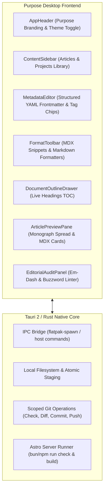

# Purpose — Technical Dispatch & Monograph Desktop Editor

**Purpose** (v0.2.0) is a dedicated desktop application engineered specifically for **The Technical Dispatch & Notebook**. Built with a modern **React 19 + TypeScript + Vite** frontend inside a native **Tauri 2 + Rust** desktop shell and packaged as a containerized **Flatpak** for Linux.

It gives authors an archival, distraction-free environment to draft and publish technical monographs, engineering notes, interactive MDX components, and mathematical treatises directly into their Astro content collections.

---

## Architecture & Visual System



### Design Language & Typography
Purpose matches the site's editorial design system:
- **Warm Light Mode (Default)**: Archival Book Paper / Ivory Stock (`#F8F6F0` background, `#FFFFFF` surface, `#1C1B18` charcoal typography, `#DDD7C8` borders, `#B83E18` terracotta accents).
- **Slate-Graphite Dark Mode**: Optional night edition (`#161614` background, `#1E1D1A` surface, `#EDE8DE` text, `#E25835` accent) with instant toggle (<kbd>Ctrl</kbd>+<kbd>Shift</kbd>+<kbd>T</kbd>).
- **Typography**: Display serif (`Fraunces`), monograph body serif (`Newsreader`), clean sans (`Inter`), and monospace code (`IBM Plex Mono`).

---

## Core Capabilities

### 1. Synchronized MDX Component Catalog
Full snippet insertion, linting, and visual approximation cards for all 13 interactive site components:
- `<EngineeringNote kind="decision|assumption|limitation|observation" title="...">`: Formal engineering callouts with kind badge and archival styling.
- `<EquationBlock equation="..." label="..." description="..." variables={[...]}>`: LaTeX math blocks with variable dictionaries.
- `<Measurement label="..." value={...} unit="..." uncertainty={...} method="...">`: Empirical measurements with explicit uncertainty bounds.
- `<LinePlot>`, `<FunctionPlot>`, `<ScatterPlot>`, `<HeatmapPlot>`: High-performance scientific curve and intensity plots.
- `<MetricGrid>`, `<MetricCard>`: KPI metric boards with Satteri delta indicators.
- `<DataTable>`: Searchable, sortable engineering test matrices with CSV export.
- `<NotebookCell>`, `<ParamPlayground>`, `<ParamSlider>`, `<Tooltip>`.

### 2. Document Outline Drawer
- Real-time hierarchy tree extraction of `#`, `##`, and `###` headings from the active document.
- One-click jump-to-section navigation (<kbd>Ctrl</kbd>+<kbd>Shift</kbd>+<kbd>O</kbd>) that synchronizes editor cursor position and scroll state.

### 3. Interactive Tag Chip Editor
- Replaces plain comma-delimited strings with interactive chips.
- Add tags via <kbd>Enter</kbd> or comma; remove via <kbd>Backspace</kbd> or <kbd>×</kbd>.
- Autocomplete suggestions dynamically aggregated across existing articles and projects in the repository.

### 4. Editorial Integrity & Style Linter
- **Em-Dash Prevention**: The site style strictly forbids em dashes (`—`). Purpose flags them in real time and provides a one-click automated fixer (<kbd>Ctrl</kbd>+<kbd>Shift</kbd>+<kbd>E</kbd>).
- **Corporate Buzzword Audit**: Identifies marketing fluff ("paradigm shift", "game-changer", "revolutionize") and suggests precise technical alternatives.
- **Missing Import Detection**: Automatically checks MDX component usage against imports and generates the correct `@components/mdx` import statement.

### 5. Technical Writing Metrics & Ergonomics
- Live status bar displaying total word count, character count, estimated reading time (`~X min`), and real-time cursor coordinates (`Ln X, Col Y`).
- Word wrap toggle (<kbd>Ctrl</kbd>+<kbd>Shift</kbd>+<kbd>W</kbd>) with horizontal scrolling support.
- Native middle-click autoscroll on Linux and desktop environments.
- Drag-and-drop local image insertion with automatic relative pathing into `images/`.

### 6. Package Manager & Schema Synchronization
- **Multi-Package Manager Engine**: Auto-detects Bun (`bun.lock`/`bun.lockb`), PNPM (`pnpm-lock.yaml`), Yarn (`yarn.lock`), or npm (`package-lock.json`), executing isolated commands (`<pm> run check`, `<pm> run build`, `<pm> install`, `<pm> run dev`) with streaming log output and process group cancellation.
- **Dynamic Content Schema**: Real AST extraction of `src/content.config.ts` synchronizing `PROJECT_STATUSES` (including `Released`), `PROJECT_DRAWINGS`, `art`, `visuals`, and `engineering` specifications across TypeScript and Rust.
- **Data Safety Guarantees**:
  - **Draft Autosave Recovery**: Persists dirty editor buffers every 2 seconds, offering recovery upon reopening.
  - **Conflict Resolution Modal**: Detects external modifications on disk before saves with side-by-side diff comparison, reload, or overwrite options.
  - **Window Close Guard**: Prevents accidental exit with unsaved modifications.
  - **Safe Deletion**: Routes deletions through the OS trash via `trash` crate rather than unrecoverable unlinking.


---

## Keyboard Shortcuts

| Shortcut | Action |
| :--- | :--- |
| <kbd>Ctrl</kbd> + <kbd>S</kbd> | Save document to disk (preserves YAML header formatting) |
| <kbd>Ctrl</kbd> + <kbd>Shift</kbd> + <kbd>T</kbd> | Toggle Light / Dark theme |
| <kbd>Ctrl</kbd> + <kbd>Shift</kbd> + <kbd>O</kbd> | Toggle Document Outline drawer |
| <kbd>Ctrl</kbd> + <kbd>Shift</kbd> + <kbd>W</kbd> | Toggle Word Wrap on / off |
| <kbd>Ctrl</kbd> + <kbd>Shift</kbd> + <kbd>P</kbd> | Toggle Raw Source YAML mode vs Visual Form |
| <kbd>Ctrl</kbd> + <kbd>Shift</kbd> + <kbd>E</kbd> | Automatically fix all forbidden em dashes |
| <kbd>Ctrl</kbd> + <kbd>B</kbd> | Format selection as **bold** |
| <kbd>Ctrl</kbd> + <kbd>I</kbd> | Format selection as *italic* |
| <kbd>Ctrl</kbd> + <kbd>K</kbd> | Insert Markdown link |
| <kbd>?</kbd> | Open Keyboard Shortcuts modal (when not focused in text) |
| <kbd>Middle Click</kbd> | Autoscroll view in any direction |
| <kbd>Esc</kbd> | Dismiss any active dialog, outline drawer, or modal |

---

## Local Development & Testing

### Prerequisites
- Node.js 22+ & npm
- Rust toolchain (stable)
- Linux WebKitGTK & Tauri dependencies (Fedora: `javascriptcoregtk4.1-devel libsoup3-devel webkit2gtk4.1-devel`)

### Commands
```bash
# Install dependencies
npm ci

# Run Vitest test suite
npm test

# Start frontend development server (http://127.0.0.1:1420)
npm run dev

# Run full desktop application under Tauri
npm run tauri:dev

# Compile TypeScript and build production web frontend bundle (dist/)
npm run build
```

---

## Packaging & Flatpak Distribution

Purpose is packaged as a sandboxed Flatpak application (`com.glitchslayed.site-editor`) using the **GNOME 49 Platform & SDK**:

```bash
# 1. Compile native binary inside GNOME 49 container with rust-stable extension
flatpak run --user --share=network \
  --env=FLATPAK_ENABLE_SDK_EXT=rust-stable \
  --filesystem=host --command=bash org.gnome.Sdk -c "
    cd '$(pwd)/src-tauri'
    export PATH='/usr/lib/sdk/rust-stable/bin:$PATH'
    cargo build --release
  "

# 2. Stage Flatpak assets
stage="src-tauri/target/flatpak-stage"
mkdir -p "$stage/bin" "$stage/share/applications" "$stage/share/icons/hicolor/scalable/apps" "$stage/share/metainfo"
install -Dm755 src-tauri/target/release/glitchys-site-editor "$stage/bin/glitchys-site-editor"
install -Dm644 packaging/com.glitchslayed.site-editor.desktop "$stage/share/applications/com.glitchslayed.site-editor.desktop"
install -Dm644 packaging/icons/hicolor/scalable/apps/com.glitchslayed.site-editor.svg "$stage/share/icons/hicolor/scalable/apps/com.glitchslayed.site-editor.svg"
install -Dm644 packaging/com.glitchslayed.site-editor.metainfo.xml "$stage/share/metainfo/com.glitchslayed.site-editor.metainfo.xml"

# 3. Build and install for current user
flatpak run --filesystem=host org.flatpak.Builder --user --install --force-clean build-dir packaging/com.glitchslayed.site-editor.yml

# 4. Create standalone bundle (.flatpak)
flatpak run --filesystem=host org.flatpak.Builder --export-only --repo=repo build-dir packaging/com.glitchslayed.site-editor.yml
flatpak build-bundle repo glitchys-site-editor.flatpak com.glitchslayed.site-editor master --runtime-repo=https://dl.flathub.org/repo/flathub.flatpakrepo
```

To run the installed application:
```bash
flatpak run com.glitchslayed.site-editor
```

---

## Continuous Integration & Releases

Automated builds and GitHub Releases are handled via GitHub Actions in [`.github/workflows/flatpak-release.yml`](.github/workflows/flatpak-release.yml):
- Every push to `main` verifies compilation, frontend bundle, and containerized Flatpak assembly.
- Any version tag (e.g. `v0.2.0`) builds the standalone `.flatpak` bundle and publishes a GitHub Release automatically.
